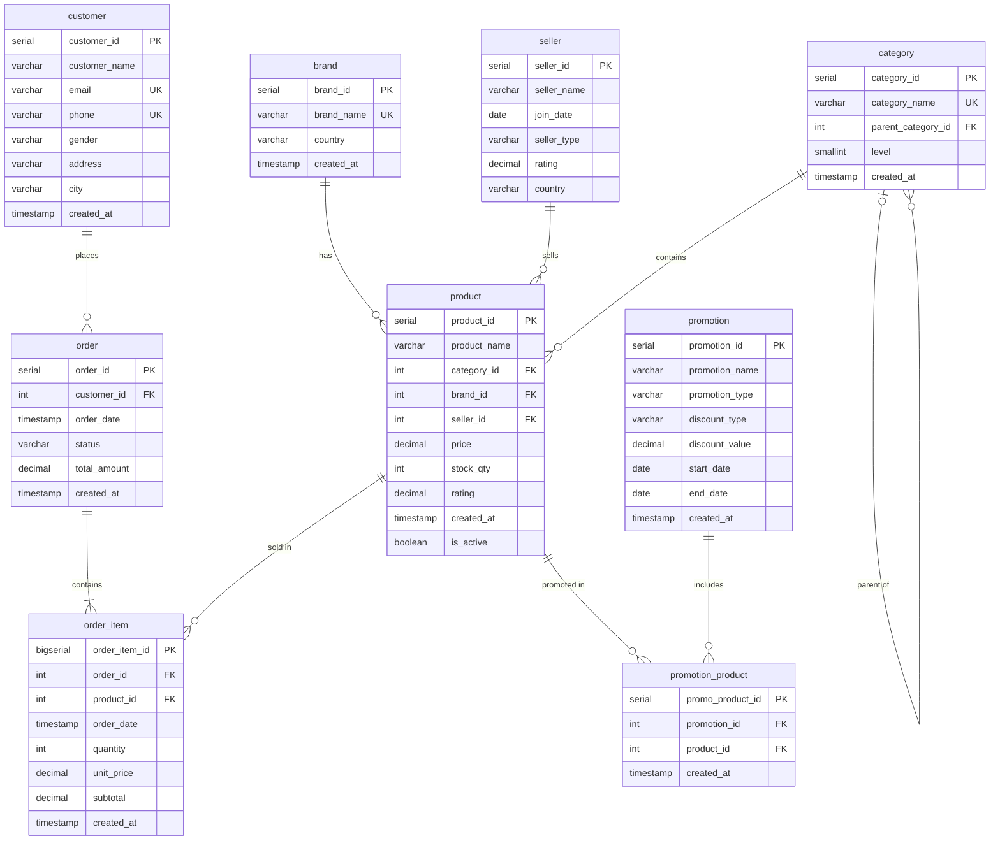

# E-commerce Synthetic Data (Project 03 – Python in Data)

Generates synthetic data for an e-commerce OLTP system with **Python + Faker**
and loads it into **PostgreSQL**, keeping all foreign keys and business rules consistent.

## Schema



Full DDL with all constraints: [`sql/schema.sql`](sql/schema.sql)

## Data volume

| Table             | Rows                 |
| ----------------- | -------------------- |
| brand             | 20                   |
| category          | 25 (5 main + 20 sub) |
| seller            | 50                   |
| customer          | 30,000               |
| product           | 3,000                |
| promotion         | 30                   |
| promotion_product | 500                  |

`order` and `order_item` are created empty; they are filled in Project 04 (SQL).

## Project structure

```
ecommerce-synthetic-data/
├── README.md
├── pyproject.toml / uv.lock     # dependencies (uv)
├── .env.example                 # database connection template
├── sql/
│   ├── schema.sql               # DDL for all 9 tables
│   └── validation.sql           # data quality checks
├── src/
│   └── generate.py              # data generation + load
└── docs/
    ├── validation_results.txt   # output of validation.sql
    ├── sample_customer.csv
    └── sample_product.csv
```

## How to run

1. Install dependencies: `uv sync`
2. Copy `.env.example` to `.env` and set your database password
3. Create the database: `psql -h localhost -U postgres -c "CREATE DATABASE ecommerce;"`
4. Create the tables: `psql -h localhost -U postgres -d ecommerce -f sql/schema.sql`
5. Generate and load the data: `uv run src/generate.py`
6. Validate: `psql -h localhost -U postgres -d ecommerce -f sql/validation.sql`

The script is re-runnable: it truncates all tables and resets IDs before loading,
and runs in a single transaction (all tables load, or none do).

## Data quality rules

**Enforced by the database:** primary keys, foreign keys, UNIQUE and CHECK constraints
(plus extra ones added beyond the brief: `NOT NULL` foreign keys, category level/parent consistency,
allowed `promotion_type` values).

**Enforced by the generator:**

- Products belong only to sub-categories (level 2)
- Products are created after their brand, category and seller
- Sub-categories are created after their parent category
- Customer names match gender; emails are built from the name; phone numbers are unique 10-digit Vietnamese mobiles
- Promotions are created before they start; discount values depend on the discount type
- Promotion–product links are created between promotion creation and start date
- Category / seller promotions only include products of one category / seller; only active products are promoted
- Fixed discounts (max 50,000 VND) are below the cheapest product (100,000 VND), so discounted prices stay positive

Validation results: [`docs/validation_results.txt`](docs/validation_results.txt)

## Notes on the brief

- Faker date hints with string dates (`'2024-01-01'`) were replaced with `datetime` objects
- Faker `country()` can return names longer than `VARCHAR(50)` → regenerated, not truncated
- Brands and categories are created before June 2024 so they exist before any product
- Promotion start dates end on April 30, giving ~7–8 promotions/month for Jan–Apr (the brief mentions ~6/month for Jan–May)
- ~167 orders per customer over 5 months is unrealistic, but required to reach the Project 04 volume
